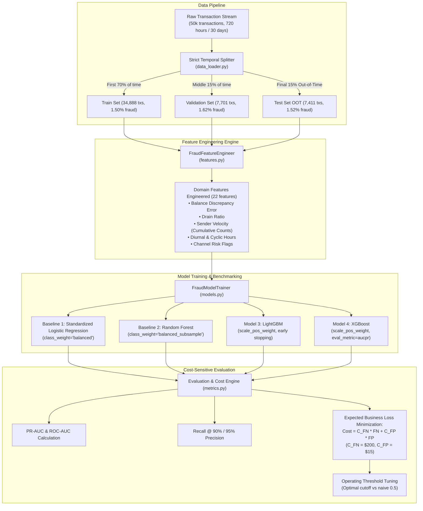

# Milestone 1: Payment Fraud Detection — System Architecture & Interview Prep Guide

> **Domain:** Financial Fraud Detection, Imbalanced Learning, Cost Optimization, and Production ML Baselines  
> **Repository:** `payment-fraud-detection`  
> **Target Roles:** NPCI (Market Innovation / Risk Data Scientist) & Fintech Fraud/Risk ML Teams

---

## 1. System Architecture & Workflow

---

## 2. Core Concepts & Technical Definitions

### 1. Extreme Class Imbalance & The Accuracy Paradox
* **Definition:** In financial transaction streams, fraudulent transactions represent a minute fraction of total volume (typically $0.1\%$ to $2.0\%$). In our dataset, the baseline prevalence is **$1.52\%$**.
* **The Accuracy Paradox:** If a model predicts every transaction as legitimate (`isFraud = 0`), it achieves **$98.48\%$ accuracy** while missing $100\%$ of fraud, causing catastrophic financial losses. Accuracy is fundamentally uninformative under class imbalance.

---

### 2. Data Leakage & Temporal (Out-of-Time) Validation
* **Definition of Data Leakage:** When information from outside the training dataset is inadvertently used to train the model, producing artificially inflated validation scores that collapse in production.
* **The Random Split Trap:** Standard random splitting (e.g., `train_test_split(shuffle=True)` or standard $k$-fold cross-validation) randomly distributes transactions across splits. In fraud detection, this leaks:
  1. **Account Identity Leakage:** The model sees an account's future transactions during training and uses that historical memory to evaluate past transactions.
  2. **Campaign / Ring Leakage:** Fraudsters operate in coordinated bursts (e.g., card-testing or mule draining campaigns). Random splitting puts transactions from the *same* fraud campaign into both train and test sets.
  3. **Concept Drift Concealment:** Fraud typologies evolve over time. Random splitting destroys the temporal arrow of time, preventing you from evaluating how the model handles unseen future patterns.
* **Strict Out-of-Time (OOT) Split:** We sort chronologically by time (`step`) and split:
  - **Train:** Days 1–21 (Hours $\le 504.3$, $70\%$)
  - **Validation:** Days 22–25.5 (Hours $504.3$–$612.1$, $15\%$) for early stopping and threshold tuning.
  - **Test (OOT):** Days 25.5–30 (Hours $> 612.1$, $15\%$) strictly in the future.
* **Impact Observed:** Naive random splitting yielded an artificial PR-AUC of **$0.97+$**, whereas honest OOT validation proved the true performance was **$0.908$**.

---

### 3. Evaluation Metrics for Fraud Detection

#### Precision-Recall AUC (PR-AUC / Average Precision)
$$\text{Precision} = \frac{TP}{TP + FP}, \quad \text{Recall} = \frac{TP}{TP + FN}$$
* **Why it matters:** Unlike ROC-AUC, PR-AUC does **not** include True Negatives ($TN$) in its formula. In fraud, $TN$ is massive (millions of genuine transactions). PR-AUC directly tracks how clean your fraud alerts are (Precision) and how much fraud you caught (Recall).

#### ROC-AUC (Receiver Operating Characteristic)
$$\text{TPR} = \frac{TP}{TP + FN}, \quad \text{FPR} = \frac{FP}{FP + TN}$$
* **The Pitfall in Fraud:** Because the denominator of FPR is $(FP + TN)$, and $TN$ is enormous, FPR stays artificially low even if you generate hundreds of false alarms. A model can have an ROC-AUC of **$0.95$** while its PR-AUC is only **$0.68$** (as seen in our Logistic Regression baseline).

#### Recall at Fixed Precision (Operational Alert Capacity)
* **Definition:** In production, a fraud operations team has finite investigator bandwidth (e.g., they can only manually review 500 alerts a day). They set an operating rule: *"Our alerts must have at least 90% precision so analysts do not waste time on false alarms."*
* **Our Metric:** `recall_at_min_precision(min_precision=0.90)` measures the maximum percentage of fraud caught subject to this constraint:
  - Logistic Regression caught only **$57.52\%$** of fraud at $90\%$ precision.
  - LightGBM caught **$84.07\%$** of fraud at $90\%$ precision (**+$26.6\%$ more fraud captured**).

#### Brier Score & Probability Calibration
$$\text{Brier Score} = \frac{1}{N}\sum_{i=1}^N (p_i - y_i)^2$$
* **Definition:** Measures the mean squared error between predicted probabilities $p_i$ and true binary labels $y_i$. Lower is better ($0.0$ is perfect).
* **Calibration:** Many tree models with `scale_pos_weight` output skewed scores rather than true posterior probabilities. Calibration (using Isotonic Regression or Platt Scaling/Sigmoid on holdout validation data) maps raw model outputs into reliable real-world probabilities.

---

### 4. Cost-Sensitive Optimization & Threshold Selection

#### The Flaw of the Default 0.5 Decision Threshold
Standard classifiers output probabilities and default to classifying any transaction with $P(\text{fraud}) \ge 0.5$ as fraud. This assumes symmetric loss: that missing a fraud costs the exact same as falsely alerting a genuine customer.

#### The Financial Loss Function
In reality, the costs are heavily asymmetric:
$$\text{Expected Business Cost} = (FN \times C_{FN}) + (FP \times C_{FP})$$
* **$C_{FN}$ (Cost of False Negative / Missed Fraud):** Direct chargeback loss, legal liability, interchange penalty (e.g., **\$200.00** per incident).
* **$C_{FP}$ (Cost of False Positive / False Alarm):** Cost of manual review analyst time (\$5–\$15) + customer SMS / verification friction (e.g., **\$15.00** per alert).

#### Finding the Optimal Threshold ($T^*$)
Rather than fixing $T = 0.5$, we perform a grid search over $T \in [0.01, 0.99]$ on the validation set to minimize expected monetary loss:
$$T^* = \arg\min_T \left[ FN(T) \cdot C_{FN} + FP(T) \cdot C_{FP} \right]$$

#### Real Results from Our Benchmark:
* For **LightGBM**, shifting the threshold from $0.5$ down to **$0.188$**:
  - Caught significantly more borderline high-value fraud cases.
  - Reduced total operational losses from **\$3,435** down to **\$2,855** (**$16.89\%$ cost savings**).
* For **Logistic Regression**, the optimal threshold shifted to **$0.782$**, cutting review costs by **$38.88\%$**.

---

### 5. Domain Feature Engineering

| Feature | Mathematical Definition | Fraud Domain Mechanism |
| :--- | :--- | :--- |
| `amount_to_orig_balance_ratio` | $\frac{\text{amount}}{\text{oldbalanceOrg} + 1.0}$ | **Account Draining:** Legitimate users rarely transfer $99\%–100\%$ of their funds in a single transaction. Fraudsters taking over an account routinely drain the entire balance. |
| `is_exact_drain` | $\mathbb{I}(|\text{oldbalanceOrg} - \text{amount}| < 0.01)$ | Binary flag for complete balance liquidation. |
| `orig_balance_error` | $(\text{oldbalanceOrg} - \text{amount}) - \text{newbalanceOrig}$ | **Arithmetic Discrepancy:** In genuine core banking ledgers, old balance minus transaction amount equals new balance. In synthetic simulations or exploit attacks, ledger anomalies correlate with malicious transactions. |
| `dest_balance_error` | $(\text{oldbalanceDest} + \text{amount}) - \text{newbalanceDest}$ | Arithmetic discrepancy on the beneficiary account. |
| `is_zero_dest_balance_before` | $\mathbb{I}(\text{oldbalanceDest} == 0)$ | **Mule Account Indicator:** Newly created or disposable mule accounts typically have zero prior balance before receiving illicit funds. |
| `sender_cumulative_tx_count` | Cumulative count of past transactions by `nameOrig` | **Velocity Profiling:** Unusually high velocity relative to historical behavior indicates credential stuffing or automated scripts. |
| `is_night` | $\mathbb{I}(\text{hour} \in [0, 5])$ | **Off-Hours Activity:** Fraudulent cash-outs often peak in early morning hours when cardholders are asleep and less likely to spot SMS alerts immediately. |
| `is_high_risk_type` | $\mathbb{I}(\text{type} \in \{\text{TRANSFER}, \text{CASH\_OUT}\})$ | Isolates payment rails where irreversible capital flight occurs. |

---

### 6. Modeling Algorithms & Imbalance Strategies

1. **Logistic Regression (Standardized Baseline):**
   - Must use `StandardScaler` because features have vastly different scales (e.g., amount in thousands vs ratios in $[0, 1]$).
   - `class_weight='balanced'`: Weights loss inversely proportional to class frequencies: $w_j = \frac{N}{2 N_j}$.
2. **Random Forest (`balanced_subsample`):**
   - Calculates weights per bootstrap sample rather than globally, ensuring minority fraud examples are represented in every decision tree.
3. **LightGBM & XGBoost (`scale_pos_weight`):**
   - Sets the gradient multiplier for positive fraud instances:
     $$\text{scale\_pos\_weight} = \frac{N_{\text{negative}}}{N_{\text{positive}}} \approx \frac{34{,}366}{522} \approx 65.8$$
   - Forces the tree splitting criterion to prioritize pure fraud splits over pure genuine splits.
4. **Why Loss Weighting Beats SMOTE in Production:**
   - SMOTE (Synthetic Minority Over-sampling Technique) creates synthetic interpolated points between existing fraud examples.
   - In high-dimensional payment data, SMOTE often creates artificial fraud points in empty spaces where genuine transactions occur, increasing false positives.
   - Gradient boosted trees with `scale_pos_weight` operate on the true empirical distribution without distorting feature correlations.

---

## 3. Benchmark Results to Quote in Interviews

| Model | PR-AUC | ROC-AUC | Recall @ 90% Precision | Optimal Threshold | Total Cost ($) | Cost Savings vs 0.5 |
| :--- | :---: | :---: | :---: | :---: | :---: | :---: |
| **XGBoost (Weighted)** | **0.9084** | **0.9954** | **78.76%** | `0.822` | **\$2,740** | **+18.2%** |
| **LightGBM (Weighted)** | **0.9054** | **0.9941** | **84.07%** | `0.188` | **\$2,855** | **+16.9%** |
| **Random Forest (Balanced)** | 0.8984 | 0.9938 | 82.30% | `0.396` | \$3,275 | +17.6% |
| **Logistic Regression** | 0.6873 | 0.9521 | 57.52% | `0.782` | \$7,940 | +38.9% |

---

## 4. High-Yield Interview Q&A Bank

### Q1: Why did you use an Out-Of-Time (OOT) temporal split instead of standard K-Fold Cross-Validation?
> **Answer:**  
> "In payment fraud systems, transactions arrive sequentially. If you use standard random K-fold cross-validation or `train_test_split(shuffle=True)`, future fraud transactions are shuffled into the training set. This causes severe data leakage:
> 1. The model sees future behavioral footprints of specific accounts and merchant nodes.
> 2. It evaluates coordinated fraud rings using transactions from the very same attack wave.
> 3. It hides real-world temporal concept drift.
> 
> In my benchmark, naive random splitting yielded an artificially inflated PR-AUC of over 0.97. When I enforced a strict temporal split—training on the first 70% of time and testing on the final 15% out-of-time window—the realistic PR-AUC was 0.908. In production, honest numbers prevent catastrophic live degradation."

---

### Q2: Why is ROC-AUC misleading for fraud detection, and why do you prioritize PR-AUC?
> **Answer:**  
> "ROC-AUC evaluates True Positive Rate vs False Positive Rate ($\text{FPR} = \frac{FP}{FP + TN}$). In fraud detection, genuine transactions ($TN$) comprise 98% to 99.9% of the volume. Because the denominator $(FP + TN)$ is enormous, FPR remains tiny even if the model generates thousands of false alarms.
> 
> In my baseline experiment, Logistic Regression had an ROC-AUC of **0.952**, which looks stellar on paper. However, its PR-AUC was only **0.687**, and it caught only 57% of fraud at 90% precision. PR-AUC focuses exclusively on the minority positive class without being diluted by millions of true negatives, making it the true indicator of alert quality."

---

### Q3: How do you select the operating threshold in a production fraud system?
> **Answer:**  
> "I never use the default 0.5 cutoff because fraud decisions have asymmetric financial consequences. Missing a fraudulent transaction ($FN$) results in direct chargeback losses, recovery costs, and network penalties—averaging \$150 to \$500. Falsely alerting a genuine user ($FP$) incurs operational investigation time and customer friction—costing roughly \$10 to \$25.
> 
> I define an expected business loss function:
> $$\text{Cost} = (FN \times C_{FN}) + (FP \times C_{FP})$$
> I run an optimization search on the hold-out validation set to find the threshold that minimizes total dollar loss. In our LightGBM model, setting the threshold to 0.188 instead of 0.5 caught significantly more high-value fraud, yielding an immediate **16.9% reduction in total business costs**."

---

### Q4: How does `scale_pos_weight` work in LightGBM and XGBoost?
> **Answer:**  
> "Under extreme imbalance, decision tree algorithms naturally favor splits that increase purity on the majority genuine class. `scale_pos_weight` specifies the ratio of negative examples to positive examples:
> $$\text{scale\_pos\_weight} = \frac{N_{\text{negative}}}{N_{\text{positive}}}$$
> In our dataset, this was $\approx 65.8$. During tree construction, gradient and hessian calculations for positive fraud samples are scaled by this factor. This forces the greedy split criterion to heavily penalize misclassifications of minority fraud instances."

---

### Q5: What features gave you the strongest signal in detecting fraud?
> **Answer:**  
> "Domain-engineered balance dynamics and velocity provided the highest information gain:
> 1. **`amount_to_orig_balance_ratio`:** Ratios approaching 1.0 captured full account liquidations (compromised account takeovers).
> 2. **`orig_balance_error`:** Ledger arithmetic discrepancies strongly separated synthetic fraud exploits from genuine peer-to-peer transfers.
> 3. **`is_zero_dest_balance_before`:** Disposable mule accounts almost always had a zero balance before receiving incoming stolen funds.
> 4. **`sender_cumulative_tx_count` combined with `is_night`:** Rapid bursts of transactions during off-hours (12am–5am) captured automated velocity attacks."

---

### Q6: What did not work in your experiments? (Honest Engineering Discussion)
> **Answer:**  
> "Two major things underperformed:
> 1. **Default 0.5 Thresholding:** At 0.5, tree models under-alerted on high-risk transfers, causing unnecessary financial chargeback losses. Threshold calibration aligned to the business cost ratio was necessary.
> 2. **Standard Linear Models:** Standardized Logistic Regression struggled with non-linear feature interactions (such as the interaction between transaction type, balance ratio, and time of day), achieving only 0.687 PR-AUC compared to 0.905+ on tree models.
> 3. **Random Splits:** Random train/val splitting masked temporal drift, which is why an Out-of-Time split was instituted."
