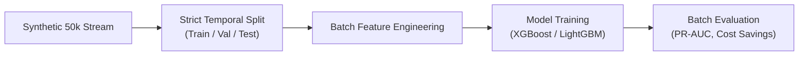
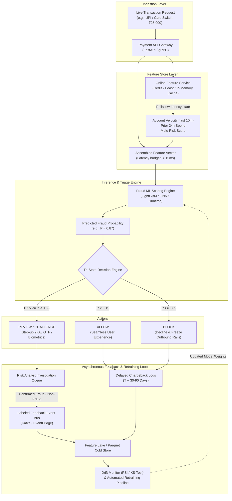

# Production Upgrade Roadmap: Stateful Feature Engineering & Real-Time Serving

> **Status:** Scheduled for Capstone Real-Time Serving Phase (Following Project 2: Graph Mule Detection)  
> **Repository:** `payment-fraud-detection`  
> **Master Architecture Plan:** See [`PRODUCTION_REALTIME_SERVING_PLAN.md`](../PRODUCTION_REALTIME_SERVING_PLAN.md)  
> **Key Themes:** Stateful Feature Pipelines, Online-Offline Feature Parity, Real-Time Decision Engines, Asynchronous Feedback Loops

---

## 1. Issue 1: The Stateful Feature Problem (`cumcount()` Split Reset)

### 1.1 The Subtle Flaw in Prototype Code
In [`FraudFeatureEngineer`](src/payment_fraud_detection/features.py):
```python
if "nameOrig" in df.columns:
    orig_tx_count = df.groupby("nameOrig").cumcount()
    feats["sender_cumulative_tx_count"] = orig_tx_count
```
When executed across temporal splits:
```python
X_train = fe.fit_transform(train_df)
X_val = fe.transform(val_df)
X_test = fe.transform(test_df)
```
Each split DataFrame is evaluated independently. As a result:

```
[TRAINING SPLIT]
Account A -> Transaction 1 (Step 10): count = 0
Account A -> Transaction 2 (Step 45): count = 1
Account A -> Transaction 3 (Step 90): count = 2

[VALIDATION SPLIT]
Account A -> Transaction 4 (Step 520): count = 0  <-- STATE IS LOST (Resets to 0)
Account A -> Transaction 5 (Step 530): count = 1
```

In the real world, Transaction 4 occurs *after* Transactions 1–3, so the risk engine should know Account A already has three historical transactions.

---

### 1.2 Why Naive Global Groupby is Dangerous (Temporal Leakage Trap)
Calculating `df.groupby("nameOrig").cumcount()` on the entire un-split dataset before splitting might seem like a quick fix, but:
1. It couples train and test datasets together in memory.
2. If timestamps are slightly out of order or if lookahead aggregations (like mean/std) are used, future information leaks into past evaluation rows.
3. It does not mimic how inference works at runtime (where transactions arrive one by one).

---

### 1.3 The Production-Grade Solution

#### Approach A: Stateful Transformer (Code-Level Fix)
Update `FraudFeatureEngineer` to maintain persistent entity state dictionaries across calls:
```python
class StatefulFraudFeatureEngineer:
    def __init__(self):
        # Persistent state carried across train -> val -> test
        self.entity_tx_counts = collections.defaultdict(int)
        self.entity_last_timestamp = {}

    def transform(self, df: pd.DataFrame, update_state: bool = True) -> pd.DataFrame:
        counts = []
        for idx, row in df.iterrows():
            user = row["nameOrig"]
            current_count = self.entity_tx_counts[user]
            counts.append(current_count)
            if update_state:
                self.entity_tx_counts[user] += 1
        feats["sender_cumulative_tx_count"] = counts
        return feats
```

#### Approach B: Sliding Window Aggregations (Fintech Standard)
Rather than lifetime cumulative counts, production systems track **sliding temporal windows**:
- Velocity in last 10 minutes ($V_{\text{10m}}$)
- Velocity in last 1 hour ($V_{\text{1h}}$)
- Cumulative volume in last 24 hours ($\Sigma_{\text{24h}}$)

#### Approach C: Online Feature Store (Redis / Feast)
- **Offline (Training):** Feast / BigQuery computes time-travel point-in-time correct joins.
- **Online (Inference):** Redis maintains sliding counters using atomic operations (`INCRBY`, `EXPIRE`).

---

## 2. Issue 2: Offline Benchmark vs. Online Real-Time Serving System

### 2.1 The Current Offline Benchmark Architecture

*Purpose:* Validate algorithms, prove domain features, and establish the cost-optimal decision threshold.

---

### 2.2 The Target Production Architecture (Real-Time Switch & Decision Engine)



---

## 3. Implementation Plan for Next Phase

| Phase | Milestone | Deliverables |
| :--- | :--- | :--- |
| **Phase 2.1** | **Stateful Feature Pipeline** | 1. Implement `StatefulFraudFeatureEngineer` carrying historical entity state chronologically.<br>2. Add sliding window features (`tx_count_last_1h`, `tx_count_last_24h`). |
| **Phase 2.2** | **Model Serialization & Registry** | 1. Export trained LightGBM pipeline to `artifacts/models/lightgbm_fraud_model.joblib`.<br>2. Save calibrated optimal threshold metadata. |
| **Phase 2.3** | **Real-Time FastAPI Endpoint** | 1. Create `POST /v1/score-transaction` endpoint.<br>2. Add in-memory state store mimicking Redis.<br>3. Return tri-state decision (`ALLOW`, `CHALLENGE`, `BLOCK`) with feature attribution. |
| **Phase 2.4** | **Feedback & Delayed Label Simulator** | 1. Simulate delayed chargeback arrival loop.<br>2. Track distribution drift and concept drift over time. |
