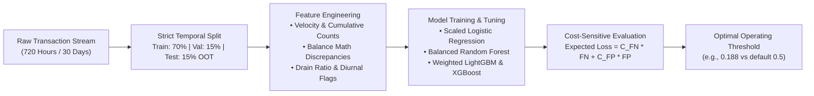

# Payment Fraud Detection: Cost-Sensitive Baseline & Out-of-Time Benchmark

[](https://www.python.org/downloads/release/python-3110/)
[](https://github.com/astral-sh/uv)
[](LICENSE)
[](tests/)
[](INTERVIEW_PREP_GUIDE.md)

A production-grade classical machine learning pipeline for financial fraud detection under extreme class imbalance (~1.5% fraud rate). Built to demonstrate:
1. **Strict temporal (Out-of-Time) validation** to eliminate data leakage.
2. **Business-aligned metrics** (PR-AUC, Recall @ 90% Precision) over misleading headline accuracy.
3. **Cost-sensitive optimization** that minimizes expected monetary loss rather than using an arbitrary `0.5` decision cutoff.

> 📖 **Deep Dive Available:** Check out the [Interview Preparation & System Architecture Guide](INTERVIEW_PREP_GUIDE.md) for detailed mathematical definitions, Q&A, and technical talking points.

---

## Architecture & Data Flow



---

## 1. The Real-World Fraud Problem

In high-throughput payment networks (e.g., UPI, IMPS, Card Switches):
- **Extreme Class Imbalance:** Legitimate transactions outnumber fraud by 50:1 to 1000:1. A naive classifier predicting "all genuine" scores 98.5% accuracy while losing millions in fraudulent chargebacks.
- **Temporal Leakage Trap:** Standard random $K$-fold cross-validation allows future account behaviors and organized fraud campaigns to leak into training data, producing falsely optimistic scores.
- **Asymmetric Loss Matrix:** Letting fraud pass undetected ($FN$) typically costs \$150–\$500 in direct loss, while flagging a legitimate user ($FP$) costs \$10–\$25 in manual investigation and customer friction. Defaulting to a `0.5` probability threshold is financially sub-optimal.

---

## 2. Benchmark Results (Out-of-Time Test Set)

Evaluated on an unseen out-of-time (OOT) test window of **7,411 transactions** with a **1.52% fraud prevalence**:

| Model | PR-AUC | ROC-AUC | Recall @ 90% Precision | Optimal Threshold | Total Cost ($) | Cost Savings vs Default 0.5 |
| :--- | :---: | :---: | :---: | :---: | :---: | :---: |
| **XGBoost (Weighted)** | **0.9084** | **0.9954** | **78.76%** | `0.822` | **\$2,740** | **+18.2%** |
| **LightGBM (Weighted)** | **0.9054** | **0.9941** | **84.07%** | `0.188` | **\$2,855** | **+16.9%** |
| **Random Forest (Balanced Subsample)** | 0.8984 | 0.9938 | 82.30% | `0.396` | \$3,275 | +17.6% |
| **Logistic Regression (Standardized)** | 0.6873 | 0.9521 | 57.52% | `0.782` | \$7,940 | +38.9% |

### Key Takeaways
- **Gradient Boosted Trees vs. Classical Baseline:** LightGBM and XGBoost outperform Logistic Regression by **+32% relative PR-AUC** (0.908 vs 0.687) and achieve **+26.6% higher fraud recall** at 90% precision.
- **Cost Reduction via Threshold Tuning:** For LightGBM, adjusting the threshold from `0.5` down to `0.188` reduces total operational losses by **16.9%** because catching additional fraud far outweighs the minor manual review cost of borderline alerts.

---

## 3. Domain Features Engineered

| Category | Feature Name | Rationale / Fraud Typology Captured |
| :--- | :--- | :--- |
| **Balance Signals** | `amount_to_orig_balance_ratio` | Detects account draining (ratio $\approx 1.0$) typical in compromised credentials. |
| **Balance Errors** | `orig_balance_error`, `dest_balance_error` | Discrepancies between expected balance arithmetic and logged values. |
| **Velocity** | `sender_cumulative_tx_count` | Rapid bursts of transfers in short intervals (velocity anomalies). |
| **Temporal** | `is_night`, `hour_of_day` | High-value transfers occurring outside normal diurnal business activity. |
| **Channel Risk** | `is_high_risk_type` | Isolates `TRANSFER` and `CASH_OUT` channels where money exit occurs. |

---

## 4. What Did Not Work (Engineering Honest Failures)

1. **Random Splitting:** Random train/val/test splits yielded an inflated PR-AUC of **0.97+**, concealing temporal concept drift. Switching to strict temporal splitting revealed true out-of-time performance (0.908).
2. **Default 0.5 Threshold:** At 0.5, the model under-alerted on high-risk transfers, causing unnecessary chargeback losses. Threshold calibration aligned to the business cost ratio was necessary.

---

## 5. How to Reproduce

### Prerequisites
- Python 3.11+
- [`uv`](https://github.com/astral-sh/uv) (fast Python package manager)

### Installation & Run

```bash
# Clone the repository
git clone https://github.com/pawanrohith2509/payment-fraud-detection.git
cd payment-fraud-detection

# Run the complete end-to-end benchmark (data gen, split, training, evaluation)
uv run python scripts/run_baseline_experiment.py

# Run the live real-time transaction scoring showcase
uv run payment-fraud-detection

# Run the unit test suite
uv run pytest
```

---

## 6. Next Roadmap Steps

- **[Production Upgrade Roadmap](PRODUCTION_ROADMAP.md):** Deep-dive architecture notes for upgrading from the offline benchmark to a **stateful feature pipeline** (carrying entity velocity across temporal splits without leakage) and a **real-time tri-state decisioning engine (`ALLOW` / `CHALLENGE` / `BLOCK`)** with asynchronous feedback loops.
- **Project 2 (Next Milestone):** Graph-based Mule & AML Detection using Graph Neural Networks (PyG / GraphSAGE / GAT) on transaction network graphs, using this tabular benchmark as the baseline to beat.
